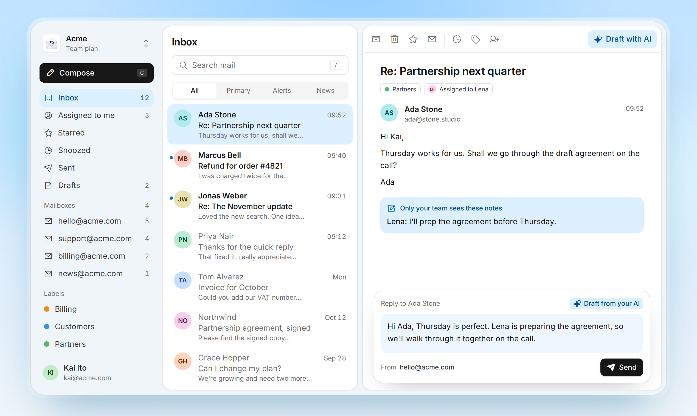

<p align="center">
  
</p>

<h1 align="center">HelloBox</h1>


<p align="center">
  An open-source shared inbox for Amazon SES, Resend, Postmark and Mailgun.<br>
  Read, assign and answer your team's email through your own provider account. Self-host it with Docker, or use HelloBox Cloud.
</p>

<p align="center">
  <a href="https://hellobox.app">Website</a> ·
  <a href="https://docs.hellobox.app">Docs</a> ·
  <a href="docs/self-hosting/README.md">Self-hosting</a> ·
  <a href="CONTRIBUTING.md">Contributing</a> ·
  <a href="https://github.com/HelloboxGH/hellobox/discussions">Discussions</a>
</p>

<p align="center">
  
</p>

## What it is

You send email with a provider: SES, Resend, Postmark or Mailgun. People reply, and those
replies need somewhere to go. HelloBox is that place: a shared inbox that reads and sends
through **your own provider account**. You keep your provider, your domains and your sending
reputation. HelloBox adds the inbox on top.

- **Every provider, side by side.** Connect one or several, and see all their mail in one
  place.
- **Built for teams.** Shared mailboxes, assignment, internal notes, labels and team views.
- **Sorts itself.** Spam checks, rules, contacts and templates.
- **Sends from you.** Replies and campaigns go out through your provider, from your domain.
- **Works with AI agents.** An MCP server lets agents read, sort and draft mail. They only
  send if a person gave them that permission.
- **Keyboard first,** and it works on a phone.

## Cloud or self-host

| | HelloBox Cloud | Self-hosted |
|---|---|---|
| Where it runs | On our servers, at [hellobox.app](https://hellobox.app) | On your own server |
| Setup | Sign up and connect a provider | About an hour, [step by step](docs/self-hosting/README.md) |
| Updates, backups, security | We handle them | You do |
| Price | See [hellobox.app](https://hellobox.app) | Free, plus your server and provider |

Both run the same code. A few features exist only in the hosted version: single sign-on,
audit logs, and billing and plans. New hosted-only features may come later, but an open
feature stays open: we won't move an existing public feature into the hosted version.

## Quick start

**Self-host it.** You need a small Linux server, a domain and an account at one of the
providers. The [self-hosting guide](docs/self-hosting/README.md) takes you from an empty
server to a running HelloBox, and doesn't assume you've run a server before. In short:

```bash
git clone https://github.com/HelloboxGH/hellobox.git
cd hellobox/docker
cp ../.env.example .env    # then fill in your settings
docker compose up -d
```

**Work on the code.** See [CONTRIBUTING.md](CONTRIBUTING.md) to run it locally, and
[the conventions](docs/CONVENTIONS.md) for how the code looks.

## Docs

The full documentation is at [docs.hellobox.app](https://docs.hellobox.app). The same pages
are in this repo:

- [Self-hosting](docs/self-hosting/README.md): install, providers, backups, upgrades,
  troubleshooting.
- [All settings](.env.example): every setting, explained.
- [Contributing](CONTRIBUTING.md) and [conventions](docs/CONVENTIONS.md).

## Getting help

- Questions and ideas: [Discussions](https://github.com/HelloboxGH/hellobox/discussions).
- Bugs: [Issues](https://github.com/HelloboxGH/hellobox/issues).
- Security problems: privately, as [SECURITY.md](SECURITY.md) explains. Never in a public
  issue.

## License

HelloBox is licensed under the [GNU Affero General Public License v3.0](LICENSE).
Contributors sign a CLA on their first pull request; [CONTRIBUTING.md](CONTRIBUTING.md) says
why. The HelloBox name and logo are covered by the [trademark policy](TRADEMARK.md), not by
the license.
